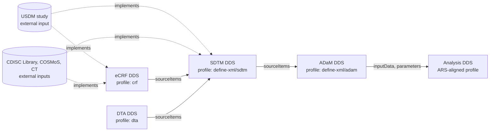

# DDS Traceability Plan

**How DDS represents data lineage, metadata provenance, and execution provenance — within one instance, across linked instances, and when metadata is loaded into DDS**

| | |
|---|---|
| Status | Draft for review — decisions to be settled in December 2026 |
| Version | 0.1.0 |
| Base model | DDS LinkML model, `dev` branch at `2146671` (2026-09-28) |
| Related | [DDS Profiling Specification](../profiles/PROFILING_SPECIFICATION.md), [DDE Solution Overview](https://github.com/cdisc-org/data-definition-engine/blob/dev/documents/Solution_Overview.md) |
| Repository | https://github.com/cdisc-org/DataExchange-DDS |

---

## Contents

1. [Purpose and scope](#1-purpose-and-scope)
2. [Background](#2-background)
3. [Design principles](#3-design-principles)
4. [Topology: linked instances](#4-topology-linked-instances)
5. [Data lineage](#5-data-lineage)
6. [Metadata provenance](#6-metadata-provenance)
7. [Validator rules](#7-validator-rules)
8. [The trace command](#8-the-trace-command)
9. [Execution provenance (designed now, built after v1.0)](#9-execution-provenance-designed-now-built-after-v10)
10. [Model and profile changes](#10-model-and-profile-changes)
11. [How lineage gets populated](#11-how-lineage-gets-populated)
12. [The v1.0 demonstrator](#12-the-v10-demonstrator)
13. [Work plan](#13-work-plan)
14. [Decisions requested](#14-decisions-requested)
15. [Open questions and risks](#15-open-questions-and-risks)
- [Appendix A — Worked example: linked eCRF and SDTM instances](#appendix-a--worked-example-linked-ecrf-and-sdtm-instances)
- [Appendix B — Mappings to PROV-O, Define-XML, and ARS](#appendix-b--mappings-to-prov-o-define-xml-and-ars)
- [Appendix C — Trace-XML features and their DDS equivalents](#appendix-c--trace-xml-features-and-their-dds-equivalents)

---

## 1. Purpose and scope

DDS is meant to drive automation of regulated data processes, and generative AI will be used both to load DDS and to act on it. Both facts raise the bar for traceability: a reviewer must be able to see where every variable came from and how it was produced, and a sponsor must be able to show where every piece of the metadata itself came from. This plan defines how DDS expresses that, settles the open structural question (one instance or linked instances), and lays out the work needed to meet the v1.0 roadmap.

The plan distinguishes three kinds of traceability. They answer different questions, live in different places, and mature on different schedules.

| Kind | Question it answers | Recorded in | v1.0 status |
|---|---|---|---|
| **Data lineage** | Which source items, methods, and conditions produce this variable, back to where the data started? | The DDS instance(s): `Item.origin`, `Item.method`, `Method` parameters, `Analysis`, `Display` | Designed eCRF → SDTM → ADaM → analysis results; **built and verified for eCRF → SDTM** |
| **Metadata provenance** | What external standard element does this DDS element implement, and which inputs and tool versions produced it? | The DDS instance: new `implements`, `inputs`, and `generation` structures | **Designed and built** |
| **Execution provenance** | What ran, when, by whom or what, on which data, using which version of the DDS? | A run record kept beside the DDS, not inside it | **Designed; built after v1.0** |

Data lineage is a property of the *specification*: it holds for every run that conforms to the DDS. Execution provenance is a property of a *run*. Keeping them apart is what lets DDS stay a reviewable, versioned specification while still supporting full audit trails.

### 1.1 In scope

- Variable-level and value-level lineage across eCRF, SDTM, ADaM, and analysis results, within one DDS instance and across linked instances.
- References from DDS elements to what they implement outside the instance (SDTMIG and ADaMIG variables, CDASHIG fields, COSMoS biomedical concepts and dataset specializations, USDM elements).
- A record of each instance's inputs, their versions, and the generating tools.
- A required conformance claim on every instance.
- Validator rules and a `trace` command that make all of the above computable and testable.
- The design, and the v1.0 model hooks, for execution provenance.

### 1.2 Out of scope

- **Record-level lineage** (which source records produced which output records). That is execution data, and it belongs to pipeline tooling working from the run record, not to DDS.
- **Changes to Define-XML.** Define-XML remains the submission artifact. Its origin and method text is generated from DDS lineage (Section 5.6); the standard itself is not touched.
- **Building the execution provenance tooling.** Only the design and the model hooks are part of v1.0.

---

## 2. Background

### 2.1 What Define-XML v2.1 provides, and where it stops

Define-XML v2.1 has traceability built in: `def:Origin` with `Type` and `Source`, `MethodDef` with descriptions and optional `FormalExpression`s, value-level metadata through `ValueListDef` and `WhereClauseDef`, and `def:DocumentRef` page references into the annotated CRF. That made it the de facto traceability record for regulatory review, but it has four limits that DDS has to move past:

1. **It is written for people, not machines.** A `Predecessor` origin names its source in free text (`DM.AGE`). A `MethodDef` does not have to declare its inputs, so nothing ties a derivation's description to the variables it actually reads.
2. **It cannot be tested end to end.** No rule checks that every derived variable traces back to a collected, assigned, or protocol-specified value, and nothing can — the links are not computable.
3. **Each file is a dead end.** The SDTM and ADaM Define-XML files are separate documents with no machine-resolvable links between them, and the CRF exists only as PDF pages.
4. **It does not cover the lifecycle.** The Analysis Results Metadata extension describes displays and analyses, but nothing reaches analysis results datasets, and nothing records which standards, terminology, protocol, or tool versions produced the metadata.

### 2.2 Trace-XML as the precedent

[Trace-XML](https://github.com/swhume/trace-xml-java) showed that computable traceability is achievable with the current submission standards. It combined a Define-XML extension with software and delivered three things that DDS needs to match:

- verifiable, computable end-to-end traceability that can be visualized and reviewed;
- validation of end-to-end traceability for every variable in a submission;
- a query for any variable that returns its full trace, including derivations, transformations, and value-level metadata.

DDS keeps those goals and changes the setting. It uses LinkML and JSON rather than an XML extension, links separate instances rather than separate files, adds metadata provenance and execution provenance, and reaches analysis results. Appendix C maps each Trace-XML feature to its DDS mechanism.

### 2.3 Current state of DDS and DDE

The model already contains most of the lineage vocabulary that Define-XML has. What is missing is population, cross-instance reference, and checking. Findings from the `dev` branches of DataExchange-DDS and the Data Definition Engine (DDE):

| Capability | Where in the model | State today |
|---|---|---|
| Origin type and source | `Item.origin` → `Origin.type` (`OriginType`, NCI C170449), `Origin.source` | Populated, though some generated instances still carry `__PLACEHOLDER__` types. The NCT01797120 SDTM instance and the archived define-json examples serialize `origin` as an object rather than a list, a known producer bug. |
| Source items | `Origin.sourceItems` → `SourceItem.item` (local OID), `document`, `resource`, `coding` | Present but **populated in none** of the instances examined: NCT01797120 SDTM, the DDE CRF fixture, and the four archived define-json examples. The archived `defineV21-ADaM.json` has 76 Predecessor origins and not one names its source. |
| Methods and inputs | `Item.method` → `Method.expressions` → `FormalExpression.parameters` → `Parameter.items` | Present. Nothing checks that parameter items match the origin's source items. |
| Analysis | `Analysis` (is_a `Method`): `inputData`, `analysisMethod`, `applicableWhen`; `Display.analysis` | Populated only in the archived ADaM examples converted from Define-XML (LZZT: 18 analyses, 14 displays). There, `inputData` mixes dataset names and variable names such as `ADSL.ITTFL`, which do not resolve to item group OIDs. |
| Internal derivation | `Governed.wasDerivedFrom` (mapped to `prov:wasDerivedFrom`) | Used by DDE for codelist subsets **and** to link a `ValueList` slice to its parent item. |
| Standards | `MetaDataVersion.standards` → `Standard`; `IsODMStandard.standard` on items and groups | Populated. The `StandardName` enum lacks `CDASHIG`, which the CRF fixture already uses. |
| Conformance claim | `IsProfile.profile` on `ItemGroup` and `Dataset` | **Not available on `MetaDataVersion`.** The CRF fixture puts `profile` at the root anyway. |
| Generating system | `ODMFileMetadata`: `originator`, `sourceSystem`, `sourceSystemVersion`, `creationDateTime` | Tool-level only. No record of inputs or their versions. |
| CRF → SDTM link | CRF profile extension `crfSdtmTarget` (forward: CRF item → SDTM items) | Populated, but targets that don't resolve are silently dropped. In the CRF fixture every CBC field's target list is empty because no LB items exist. |
| External references | CRF profile extensions `crfActivityRef` (USDM Activity id) and `crfSpecializationRef` (Library path); base slot `implementsConcept` (an in-instance concept) | Three mechanisms for one idea, two of them profile-specific, none carrying a version. |
| Topology | DDE merges eCRF forms into the SDTM instance and validates the combined instance against each profile by stripping the other profile's extensions | Works for generation. There is no cross-instance reference form. |

`profiles/example-adsl-minimal.json` shows the cross-instance problem in miniature: `IT.ADSL.USUBJID` has a `Predecessor` origin whose source item is `IT.DM.USUBJID`, which does not exist in that instance and cannot be resolved.

---

## 3. Design principles

1. **Lineage is recorded backward, on the consumer.** A target variable names its sources; a source never lists its consumers. Upstream instances (the eCRF DDS built at study setup) can then be frozen, and adding a downstream consumer never edits them. Forward views, such as impact analysis or aCRF annotations, are computed by inverting the graph. This matches Define-XML origin semantics.
2. **Use the model's existing structures first.** `Origin`, `SourceItem`, `Method`, `Parameter`, `Analysis`, and `Display` already carry lineage. New classes are added only for what the model cannot say today: cross-instance references, inputs, generation activities, and external references.
3. **One reference form, local or linked.** The same reference syntax works whether the source is in the same instance or a linked one, so a combined instance and a set of linked instances describe the same lineage.
4. **Every link is checkable.** Each rule has an identifier, a severity, a fixture that passes it, and a fixture that fails it.
5. **Claims are not proof.** A conformance claim or an `implements` reference is checked, never trusted.
6. **Metadata is not data.** DDS records the lineage of definitions. Runs are recorded beside DDS.
7. **Align with PROV-O semantically, not syntactically.** New classes and slots carry PROV-O mappings so the instance graph can be exported as PROV, without forcing PROV's serialization on DDS authors.
8. **Generate the human-readable views.** Define-XML origin text, trace reports, and lineage diagrams are generated from DDS and never maintained by hand.

---

## 4. Topology: linked instances

### 4.1 Options

| | **Single instance** | **Linked instances** |
|---|---|---|
| Shape | One DDS holds eCRF, SDTM, ADaM, and analysis metadata | One DDS per lifecycle stage and profile, joined by declared references |
| Lifecycle | Every stage reopens the same document | Each stage is created, reviewed, and versioned when its stage happens; upstream stays frozen |
| Ownership | One owner, or merge conflicts | Each stage can have its own owner, vendor, or tool |
| Profiles | Closed profile schemas need strip-and-validate for every pair of profiles | Each instance validates directly against its own profile |
| Change impact | Any change creates a new version of everything | A change versions only the stage that changed; downstream pins tell you what must be re-checked |
| Submission | Must be split for separate SDTM and ADaM Define-XML | Maps one-to-one to submission packages |
| Trace | Every reference is local | References must be resolved across instances |

### 4.2 Recommendation

**Use one DDS instance per lifecycle stage, and link them with declared, version-pinned references.** Use the same reference form for local references, so DDE's combined instance stays valid and converts to and from linked instances mechanically.



Solid arrows are data lineage (drawn in the direction data flows; recorded on the downstream instance). Dotted arrows are metadata provenance (`implements` references to external inputs).

The arguments that decide it are lifecycle and change impact. The eCRF DDS exists months before ADaM, comes from a different team, and must not change when an analysis is added. With linked instances, an SDTM DDS that pins `crf` at version 1.2 (with a checksum) proves which CRF definitions its lineage was checked against; when the CRF moves to 1.3, the pin shows exactly which downstream instances need re-checking.

### 4.3 Instance identity

A reference into another instance needs a stable identity to point at. Today `MetaDataVersion` has `OID`, `fileOID`, and `creationDateTime`, but no version and no canonical URI. Add the existing `IsProfile` mixin to `MetaDataVersion`. It brings `profile` (Section 6.6), and through `Versioned` it brings `version` and `href`.

- `version` — the instance's own version (semantic versioning recommended), independent of profile and model versions.
- `href` — the instance's canonical URI, or a resolvable location.
- **Checksum** — SHA-256 over the instance's canonical JSON ([RFC 8785](https://www.rfc-editor.org/rfc/rfc8785) JSON Canonicalization Scheme). The checksum is computed by whoever pins the instance and is never stored inside the instance it describes.

### 4.4 Declaring linked instances

A new root slot, `MetaDataVersion.linkedInstances`, lists the upstream instances this one references.

| `LinkedInstance` slot | Range | Card. | Purpose |
|---|---|---|---|
| `OID` | string | 1 | The local prefix used in qualified references, e.g. `crf`. Must not contain `:`. |
| `fileOID` | string | 1 | The linked instance's `fileOID`. |
| `version` | string | 1 | The pinned version. |
| `href` | uri | 1 | Where to resolve it: a relative path, a URL, or a registry URI. |
| `checksum` | string | 0..1 | `sha256:` followed by the hex digest of the canonical JSON. When present, it pins the exact content. |
| `profile` | uri | 0..* | The profile(s) the linked instance claims. Used to check the stage is the expected kind. |
| `description` | string | 0..1 | Human-readable note. |

`LinkedInstance` maps to `prov:Entity`, and each qualified reference into it implies `prov:wasDerivedFrom` at the element level.

### 4.5 Reference form

A reference to an element in a linked instance is a **qualified OID**: the linked instance's prefix, a colon, and the element's OID in that instance.

```
IT.VS.VSORRES               local reference (unchanged)
crf:IT.CRF.SYSBP_VSORRES    reference into the linked instance declared with OID "crf"
```

- An unqualified OID is always local.
- A qualified OID's prefix must match a `LinkedInstance.OID` in the same instance.
- OIDs must not contain `:`. Today's OIDs use `.` and `_`, so nothing existing changes.
- The form applies to every reference slot that can point across stages: `SourceItem.item`, `Parameter.items`, `Analysis.inputData`, `Method` references from items, and `WhereClause` references used in value-level lineage.

No LinkML ranges change. Reference slots already serialize as strings in JSON and JSON Schema, so qualified OIDs validate against today's schemas and profiles. Resolution and integrity are the validator's job (Section 7). The form is deliberately a CURIE: a JSON-LD context can expand `crf:` to the linked instance's `href`, which gives every DDS element a dereferenceable IRI. That should line up with whatever persistent-identifier scheme CDISC adopts.

**Alternative considered.** A structured reference such as `{"instance": "crf", "item": "IT.CRF.SYSBP_VSORRES"}` is more explicit, but it means changing the range of multivalued reference slots like `Parameter.items` and doubling the slots involved, and it does not map to IRIs as naturally. The CURIE form keeps the model change to a single new class.

### 4.6 Combined instances

DDE's combined Define-XML + CRF instance remains valid: all of its references are local. Converting between the two shapes is mechanical:

- **Split:** move each stage's elements into its own instance, add a `LinkedInstance` to the downstream instance, and prefix references that now cross the boundary.
- **Merge:** concatenate, then strip prefixes. This requires OIDs to be unique across the set, which DDE's conventions (`IT.CRF.*`, `IT.<domain>.*`) already give.

Both shapes are first-class for the validator and the trace command. The v1.0 demonstrator uses the linked shape (Section 12).

### 4.7 Forward links (`crfSdtmTarget`)

The CRF profile's `crfSdtmTarget` records the forward direction (CRF field → SDTM variables) because the aCRF needs annotation text. Under this plan:

- The backward `sourceItems` on the SDTM side is the **authoritative** lineage.
- `crfSdtmTarget` stays as a CRF-profile rendering aid for aCRF annotations. In a linked eCRF instance it keeps its annotation text and SDTM variable names but not SDTM item OIDs: an upstream instance never references a downstream one, or the instance links would form a cycle (LK-03). The item OIDs remain usable in combined instances, where they are local.
- A validator rule (LN-11) checks the two agree — by OID in a combined instance, by variable name and where clause across linked instances — so a forward target that has no matching backward source, or the reverse, is reported rather than silently dropped.
- During loading, the linker (Section 11) can write the backward links *from* `crfSdtmTarget` and the CRF specializations, so the two start out consistent.

---

## 5. Data lineage

### 5.1 The lineage graph

The validator and the trace command both work on one directed graph built from the instance and everything it links to.

| Edge | From | To | Source in the model |
|---|---|---|---|
| *sourced from* | Item | Item | `Item.origin[].sourceItems[].item` |
| *derived by* | Item | Method | `Item.method` |
| *reads* | Method | Item | `Method.expressions[].parameters[].items` |
| *value-level part of* | value-level Item | parent Item | the `ValueList` slice's `wasDerivedFrom` (Section 5.3) |
| *conditioned by* | value-level Item | WhereClause | `Item.applicableWhen` |
| *analyzes* | Analysis | ItemGroup | `Analysis.inputData` |
| *displays* | Display | Analysis | `Display.analysis` |
| *documented by* | Origin, Method, SourceItem | DocumentReference | `documents`, `document` |

The graph must be acyclic. Its **start nodes** are items whose origin starts a chain and that name no further sources.

### 5.2 Origin semantics

`OriginType` keeps its NCI C170449 values. This table fixes what each one requires for lineage purposes, which the model descriptions and validator will both state.

| Origin type | `sourceItems` | `method` | Starts a chain? | Notes |
|---|---|---|---|---|
| **Collected** | Optional | — | Yes, when it has no source items | An SDTM variable that is collected *via* an eCRF field or a DTA transfer field names that upstream item; the eCRF field itself has no source items and starts the chain. The Define-XML profiles require `source` for Collected origins (Subject, Investigator, or Vendor in the SDTM profile). |
| **Assigned** | Optional | — | Yes, when it has no source items | May name the item whose value determined the assignment (e.g. `VSTESTCD = SYSBP` because the value came from the SYSBP field). |
| **Protocol** | — | — | Yes | Should carry an `implements` reference to the USDM element it comes from (MP-06). |
| **Not Available** | — | — | Yes | |
| **Derived** | Required (≥ 1) | Required | No | Every item the method reads must be a source item, and the reverse (LN-07). |
| **Predecessor** | Required (exactly 1) | Not allowed | No | Copy of a single upstream value. |
| **Other** | Optional | Optional | No | Never completes a chain on its own. Must cite a document; reported as a warning (LN-08). |

**Chain completeness** then has one simple definition: every path backward from an item ends at a node with no source items whose origin type is Collected, Assigned, Protocol, or Not Available. An Assigned or Collected item that *does* name sources is not an end; its sources must be resolved and must themselves end correctly.

### 5.3 Value-level lineage

When a variable's sources differ by value — `VSORRES` comes from the SYSBP field for systolic pressure and the HR field for heart rate — lineage is stated on the **value-level items**, not on the parent variable. This is the Define-XML pattern, and DDS already represents it: a `ValueList` slice (`VL.VS.VSORRES`) holds items such as `IT.VS.VSORRES.SYSBP`, each with `applicableWhen` and its own `origin`.

- A value-level item's lineage is its own origin, sources, and method.
- A parent variable's lineage is the union of its own origin and every value-level item in its value list, each branch labeled with its where clause.
- A parent variable that names more than one Collected source and has no value list is ambiguous and draws a warning (LN-10). The fix is to add value-level items.

DDE links a `ValueList` slice to its parent item through the slice's `wasDerivedFrom`. The trace command uses that link. Section 15 notes that it overloads `wasDerivedFrom`, which also means "derived from a template", and proposes a dedicated slot after v1.0.

### 5.4 Method and source consistency

Define-XML cannot check that a derivation's description matches its inputs. DDS can:

- For a **Derived** item, the set of items read by its method's parameters must equal the set of its source items (LN-07, warning). A parameter item that isn't a source means the declared lineage is incomplete. A source item that no parameter reads means either the method is under-specified or the source is wrong.
- A method shared by several items (for example a unit conversion) is checked once per item that uses it, against that item's sources.
- `FormalExpression.context` names the language and version of an executable expression (for example `Python 3.12` or `SAS 9.4`). Execution provenance needs this to tie a run step to a method (Section 9).

### 5.5 Through ADaM and analysis results (ARS-aligned)

The design covers the whole lifecycle; v1.0 verifies only eCRF → SDTM.

**ADaM.** The define-xml/adam profile already narrows origins to ADaM usage. Typical lineage:

- `ADSL.AGE` — Predecessor, one source: `sdtm:IT.DM.AGE`.
- `ADSL.TRTSDT` — Derived, method `MT.ADSL.TRTSDT` reading `sdtm:IT.EX.EXSTDTC` and `sdtm:IT.EX.EXDOSE`.
- BDS `AVAL` — value-level items per `PARAMCD`, each Predecessor or Derived from the relevant SDTM result variable.

**Analysis results.** The CDISC [Analysis Results Standard](https://cdisc-org.github.io/analysis-results-standard/ReportingEvent) (ARS) is itself a LinkML model, which makes alignment a matter of declared mappings, not a format conversion. DDS carries the lineage-bearing subset and maps it to ARS:

| DDS | ARS | Lineage role |
|---|---|---|
| `Analysis` (is_a `Method`) | `Analysis` | The node an analysis result traces to |
| `Analysis.analysisMethod`, `FormalExpression` | `AnalysisMethod`, `Operation` | How results are computed |
| `Analysis.inputData` | `Analysis.dataset` | The ADaM dataset(s) read |
| `Parameter.items` (analysis variable) | `Analysis.variable` | The ADaM variable(s) analyzed |
| `Analysis.applicableWhen` → `WhereClause` | `AnalysisSet`, `DataSubset` | Population and subset conditions |
| `Display.analysis` | `Output` and its displays | Rendered output → analysis |
| (no DDS equivalent) | `OperationResult` | An ARD row; traces to its `Operation` and `Analysis` |

A trace from an analysis result then runs: ARD row (ARS `OperationResult`) → `Analysis` → analysis variable in ADaM → SDTM → eCRF field.

Where a sponsor already has an ARS `ReportingEvent`, the DDS `Analysis` elements `implement` the corresponding ARS elements by reference (Section 6.4) instead of copying them. Two gaps remain for the ADaM/ARD phase: DDS has no equivalent of ARS groupings (`GroupingFactor`, `Group`), and the identity of an individual ARD result row lives in ARS, not DDS (Section 15).

### 5.6 Rendering lineage into Define-XML

Because DDS lineage is computable, the Define-XML text is generated from it, so the two cannot drift apart:

- **Predecessor** → `def:Origin Type="Predecessor"` with a description built from the qualified source (`DM.AGE`).
- **Collected from an eCRF field** → `def:Origin Type="Collected"` with `def:DocumentRef` page references taken from the linked CRF item's aCRF pages.
- **Derived** → `MethodDef` whose description and `FormalExpression` come from the DDS method, and whose inputs can be listed from the parameters.

This is a generator change in DDE after the lineage model lands, not a v1.0 gate.

---

## 6. Metadata provenance

### 6.1 Two granularities

Metadata provenance answers "where did this definition come from?" at two levels:

- **Instance level.** What the instance was generated from: the inputs and their versions, and the generation activities (tools, versions, agents) that used them. This is the roadmap's "record on each instance of the inputs it was generated from".
- **Element level.** What each element implements outside the instance (`implements`), and, when several loaders contribute, which generation activity produced it (`generatedBy`).

The trace command joins the two: for any element it reports what it implements and which inputs produced it.

### 6.2 Inputs

A new root slot, `MetaDataVersion.inputs`, declares every input the instance was generated from. Each `Input` maps to `prov:Entity`.

| `Input` slot | Range | Card. | Notes |
|---|---|---|---|
| `OID` | string | 1 | e.g. `IN.USDM`, `IN.LIB.SDTMIG`, `IN.CT.SDTM`, `IN.COSMOS` |
| `name` | string | 1 | Human-readable name |
| `type` | `InputType` | 1 | `USDM`, `CDISC Library`, `COSMoS`, `Controlled Terminology`, `CRF Specialization`, `Sponsor Metadata`, `Data Transfer Agreement`, `DDS Instance`, `Other` |
| `version` | string | 1 | Release, package date, or file version. Required (MP-02). |
| `href` | uri | 0..1 | Where the input was obtained: file URI, API base URL, repository URL |
| `retrieved` | datetime | 0..1 | When it was retrieved — essential for API sources that change in place |
| `checksum` | string | 0..1 | `sha256:` digest of a file input |
| `standard` | `Standard` | 0..1 | The declared `Standard` this input supplies, e.g. `IN.LIB.SDTMIG` → `STD.SDTMIG` |

`standards` and `inputs` serve different purposes and both stay. `standards` says what the instance *conforms to* (normative, and needed for Define-XML generation). `inputs` says what *fed the generator*. A CDISC Library product is usually both, which is why an input can point to its standard.

### 6.3 Generation activities

A new root slot, `MetaDataVersion.generation`, records each activity that created or changed the instance's content. Each `GenerationActivity` maps to `prov:Activity`.

| `GenerationActivity` slot | Range | Card. | PROV-O | Notes |
|---|---|---|---|---|
| `OID` | string | 1 | | e.g. `GEN.CRF.1` |
| `tool` | string | 1 | | Name of the generating software |
| `toolVersion` | string | 1 | | Release version |
| `toolRevision` | string | 0..1 | | VCS commit, for unreleased builds |
| `startedAt`, `endedAt` | datetime | 0..1 | `prov:startedAtTime`, `prov:endedAtTime` | |
| `used` | `Input` | 1..* | `prov:used` | Every input must be declared (MP-04) |
| `associatedWith` | `User` \| `Organization` | 0..* | `prov:wasAssociatedWith` | People or organizations responsible for the run |
| `aiAssistance` | `AIAssistance` | 0..* | `prov:wasAssociatedWith` | AI model and version, the skill or prompt identifier and version, and its role (`generate`, `edit`, `review`) |
| `informedBy` | `GenerationActivity` | 0..* | `prov:wasInformedBy` | Earlier activities this one builds on — the chain of incremental loads |
| `targetProfile` | uri | 0..1 | | The profile the activity was producing content for |

The existing `ODMFileMetadata` slots (`originator`, `sourceSystem`, `sourceSystemVersion`) stay for ODM and Define-XML compatibility. Generators fill them from the most recent activity.

### 6.4 External source references (`implements`)

A new multivalued slot, `implements`, is added to the `Governed` mixin, so it is available on items, item groups, methods, code lists, where clauses, and the instance itself. Each value is an `ExternalReference`.

| `ExternalReference` slot | Range | Card. | Notes |
|---|---|---|---|
| `uri` | uri | 1 | The external element's identifier |
| `standard` | `Standard` | 0..1 | The declared standard it belongs to |
| `input` | `Input` | 0..1 | The declared input it belongs to |
| `version` | string | 0..1 | Optional; if given, must equal the declared standard's or input's version (MP-03) |
| `relation` | `ReferenceRelation` | 0..1 | `implements` (default): a study-specific instance of the referenced element. `specializes`: a narrowed form, e.g. value-level items from a dataset specialization. `adaptedFrom`: loosely based on, with sponsor changes. |
| `label` | string | 0..1 | e.g. `SDTMIG 3.4 VS.VSORRES` |

Exactly one of `standard` or `input` is required (MP-01). The version comes from the referenced declaration, so a reference carries no version of its own unless it wants to assert one.

Examples (URIs are illustrative; the final form follows CDISC's persistent-identifier decision):

| Element | Implements | Belongs to |
|---|---|---|
| `IT.VS.VSORRES` | `https://library.cdisc.org/api/mdr/sdtmig/3-4/datasets/VS/variables/VSORRES` | `standard: STD.SDTMIG` |
| `IT.VS.VSORRES.SYSBP` (value-level) | COSMoS SDTM dataset specialization `SYSBP` (`relation: specializes`) | `input: IN.COSMOS` |
| `IG.CON.SYSBP_DENORMALIZED` (CRF concept) | Library CRF specialization `SYSBP_DENORMALIZED`, and COSMoS biomedical concept for systolic blood pressure | `input: IN.LIB.CRF`, `input: IN.COSMOS` |
| `IG.FORM.VITAL-SIGNS` | USDM `Activity_6` → `{IN.USDM href}#Activity_6` | `input: IN.USDM` |
| `IT.ADSL.AGEGR1` | `https://library.cdisc.org/api/mdr/adam/adamig-1-3/datastructures/ADSL/variables/AGEGR1` | `standard: STD.ADAMIG` |
| `Analysis AN.EFF.1` | ARS `ReportingEvent` element `An_01` → `{IN.ARS href}#An_01` | `input: IN.ARS` |

USDM element ids are local to the USDM file, so they are referenced as fragments of the declared USDM input's `href`. Its checksum and version make the reference exact.

**Boundaries with existing slots.** Four slots now say related but different things, and the specification will state the difference:

| Slot | Says | Example |
|---|---|---|
| `coding` | What the element *means*, as a term in a code system | `VSTESTCD` value coded to NCIt `C25298` |
| `implements` | Which *external specification element* this element instantiates | `IT.VS.VSORRES` implements SDTMIG 3.4 `VS.VSORRES` |
| `wasDerivedFrom` | Which *element inside this DDS* it was derived from | A subset code list derived from the full list |
| `standard` (`IsODMStandard`) | Which declared standard a group or item *as a whole* follows | `IG.VS` follows `STD.SDTMIG` |

**Migration.** The CRF profile extensions `crfActivityRef` and `crfSpecializationRef` become `implements` references and are retired from the profile. `implementsConcept` (an in-instance `ReifiedConcept`) stays; the concept itself gets an `implements` reference to its COSMoS biomedical concept.

### 6.5 Element-level attribution (`generatedBy`)

A new optional slot, `generatedBy`, on `Governed` references the `GenerationActivity` (or activities) that created or last changed the element. It maps to `prov:wasGeneratedBy`.

- If an instance has one generation activity, every element is implicitly attributed to it and `generatedBy` can be omitted.
- With incremental loading (the DDE Solution Overview's "Metadata Provenance" requirement), each loader stamps the elements it adds or changes. This supports auditability, debugging of unexpected generator output, and conflict resolution when two sources supply the same element.
- The trace command reports the activity and, through `used`, the inputs behind any element.

### 6.6 Conformance claim

The roadmap requires a conformance claim on every instance, using the model's existing `profile` slot. Adding `IsProfile` to `MetaDataVersion` (Section 4.3) makes that slot available at the root.

- The value is the profile's canonical URI with its version segment, as in the Profiling Specification §9: `https://cdisc.org/dds/profiles/crf/1.0`.
- A combined instance lists one claim per profile, which DDE already does.
- In the base model, `profile` remains optional so the base stays usable for exploration. Every published profile makes it required and constrains it to its own canonical URI. The validator requires it on every instance it checks (CF-01).
- Claims are claims: CF-02 validates the instance against each claimed profile, using strip-and-validate when there is more than one.
- Profiling Specification §9 is updated: whole-document claims no longer need to travel out of band.

### 6.7 AI-assisted loading

DDS will be loaded and edited by AI agents, so the provenance model has to say when that happened.

- A generation activity that used an AI agent records it in `aiAssistance`, with the model, version, skill or prompt version, and role.
- Combined with `generatedBy`, a reviewer can list every element produced or changed by an AI-assisted activity and review those first.
- Whether DDS should also record a human review or acceptance per element is an open question (Section 15).
- The DDS `SKILL.md` files for AI loaders will require agents to write `inputs`, `generation`, and `implements` as they load, rather than leaving provenance for a later pass.

---

## 7. Validator rules

Rules run on the lineage graph of an instance plus everything it links to. Each rule has an identifier, a severity, at least one passing and one failing fixture, and a message that gives the reference path to the offending element and, where possible, a suggested fix — the same diagnosable-error approach that made declared exclusions (R6a) usable in profiling.

**Lineage (LN)**

| ID | Rule | Severity | v1.0 | Roadmap |
|---|---|---|---|---|
| LN-01 | Every Derived item has a method. | Error | ✓ | Lineage 2 |
| LN-02 | Every Derived item names at least one source item; every Predecessor item names exactly one. | Error | ✓ | Lineage 2 |
| LN-03 | Every source item resolves to an item, locally or in a declared linked instance. | Error | ✓ | Lineage 2 |
| LN-04 | Every method parameter item resolves to an item. | Error | ✓ | Lineage 2 |
| LN-05 | Every chain ends at an origin that starts one: Collected, Assigned, Protocol, or Not Available, with no further source items. | Error | ✓ | Lineage 2 |
| LN-06 | The lineage graph has no cycles. | Error | ✓ | |
| LN-07 | For a Derived item, the items its method reads equal its source items. | Warning | ✓ | |
| LN-08 | An Other origin cites a document and never completes a chain. | Warning | ✓ | |
| LN-09 | A Predecessor item has no method. | Error | ✓ | |
| LN-10 | A variable with more than one Collected source has a value list stating which source applies when. | Warning | ✓ | |
| LN-11 | A CRF item's `crfSdtmTarget` and the SDTM side's source items agree in both directions (by OID in a combined instance; by variable name and where clause across linked instances). | Warning | ✓ (CRF profile) | |
| LN-12 | Every `Analysis.inputData` reference resolves, and every item its parameters read belongs to an input group. | Error | ADaM/ARD phase | |
| LN-13 | Every `Display` references an `Analysis`. | Error | ADaM/ARD phase | |

**Linking (LK)**

| ID | Rule | Severity | v1.0 |
|---|---|---|---|
| LK-01 | The prefix of every qualified reference is declared in `linkedInstances`. | Error | ✓ |
| LK-02 | Every linked instance resolves at its `href`, and its `fileOID` and `version` match the declaration; when a `checksum` is declared, the content matches it. | Error | ✓ |
| LK-03 | Links between instances form a directed acyclic graph. | Error | ✓ |
| LK-04 | No OID contains `:`. | Error | ✓ |
| LK-05 | A linked instance claims a profile, and it is a profile the declaration expects. | Warning | ✓ |

**Metadata provenance (MP)**

| ID | Rule | Severity | v1.0 | Roadmap |
|---|---|---|---|---|
| MP-01 | Every external reference names exactly one standard or input that the instance declares. | Error | ✓ | Provenance 3 |
| MP-02 | Every declared standard and input carries a version. | Error | ✓ | Provenance 3 |
| MP-03 | A version given on an external reference equals the version of the standard or input it names. | Error | ✓ | |
| MP-04 | Every generation activity names a tool and version and uses at least one declared input. | Error | ✓ | Provenance 2 |
| MP-05 | Every `generatedBy` reference resolves to a declared generation activity. | Error | ✓ | |
| MP-06 | When a USDM input is declared, every Protocol-origin item implements a USDM element. | Warning | ✓ | |

**Conformance (CF)**

| ID | Rule | Severity | v1.0 | Roadmap |
|---|---|---|---|---|
| CF-01 | The instance root carries at least one profile claim, and each claim includes a version. | Error | ✓ | Lineage 3 |
| CF-02 | The instance validates against every profile it claims. | Error | ✓ | |

Some of these are already expressible as LinkML `rules` in a profile — the define-xml parent profile already requires source items for Predecessor origins. The validator still checks them independently, because chain, resolution, and cross-instance rules cannot be expressed in LinkML or JSON Schema, and because lineage must be checkable on instances whatever profile they claim.

**Output.** A JSON report (rule, severity, instance, reference path, message, suggested fix) for CI and tools, and a text summary for people. The exit code is non-zero when any error is found, so the validator can gate a pipeline.

---

## 8. The trace command

The trace command is Trace-XML's query feature for DDS. It also delivers the roadmap's requirement to report lineage back to the origin with methods and documents, plus what each element implements and which inputs produced it.

```text
dds trace INSTANCE OID [--links DIR] [--direction up|down] [--depth N]
                       [--no-provenance] [--format text|json|mermaid]
dds trace INSTANCE --all [--links DIR] [--format json]
dds validate INSTANCE [--links DIR] [--rules LN,LK,MP,CF] [--format text|json]
```

- `--direction up` (default) follows lineage back to start nodes. `down` inverts the graph across the linked set for impact analysis: "if this CRF field changes, what is affected?"
- `--links DIR` resolves linked instances from a local directory instead of their `href`s, for offline and CI use. Checksums are still verified.
- `--all` emits a trace for every item, which is Trace-XML's every-variable report.
- `--format mermaid` emits a diagram for review; `json` emits a trace record for tools.

Illustrative text output for a derived SDTM variable in the linked demonstrator:

```text
IT.VS.VSSTRESN  VSSTRESN  Numeric Result/Finding in Standard Units          [sdtm 1.0.0]
  origin     Derived (Sponsor)
  method     MT.VS.VSSTRESN  Computation  "Convert VSORRES to standard units"
             expression  [Python 3.12]  to_standard(VSORRES, VSORRESU, VSTESTCD)
  ├─ IT.VS.VSORRES  VSORRES  via value list VL.VS.VSORRES
  │   ├─ when VSTESTCD = "SYSBP"  IT.VS.VSORRES.SYSBP  Collected (Investigator)
  │   │   └─ crf:IT.CRF.SYSBP_VSORRES  [crf 1.2.0]  Collected (Investigator)    ● start
  │   └─ when VSTESTCD = "HR"     IT.VS.VSORRES.HR     Collected (Investigator)
  │       └─ crf:IT.CRF.HR_VSORRES     [crf 1.2.0]  Collected (Investigator)    ● start
  ├─ IT.VS.VSORRESU  VSORRESU  via value list VL.VS.VSORRESU   (2 branches, collapsed)
  └─ IT.VS.VSTESTCD  VSTESTCD  Assigned (Sponsor)                               ● start
  implements  SDTMIG 3.4 VS.VSSTRESN
              https://library.cdisc.org/api/mdr/sdtmig/3-4/datasets/VS/variables/VSSTRESN
  generated   GEN.SDTM.1  DDE define loader 0.9.0 (rev 1c1fe34), 2026-12-14
              used IN.USDM (USDM 4.0), IN.LIB.SDTMIG (3.4), IN.CT.SDTM (2026-03-27)
  chain       complete: 5 start nodes, 0 errors, 0 warnings
```

The JSON trace record carries the same tree with every node's instance, version, OID, origin, method, expression, documents, where clauses, `implements`, and `generatedBy`. It is the machine-readable answer to "show me the full trace for this variable", and the input to visualizations.

**Implementation.** A Python package in DataExchange-DDS (`tools/`), beside the profile resolver. It shares one lineage-graph module between `validate` and `trace`, depends only on `pyyaml` and `linkml-runtime`, and exposes a library API so DDE loaders and generators can call it directly.

---

## 9. Execution provenance (designed now, built after v1.0)

### 9.1 Where it lives

Execution provenance is recorded in a **run record** kept beside the DDS, not inside it:

- A DDS instance is a reviewed, versioned specification. Runs are events, happen many times per version, and must be immutable once written.
- A run record references the DDS by identity (`href`, `version`, checksum) and references DDS elements by qualified OID, so it can say exactly which methods produced which outputs under which specification.
- Kept apart, the two can be governed differently: the DDS goes through review and the run record goes into the audit trail.

### 9.2 Run record content

| Part | Content | PROV-O |
|---|---|---|
| Run | Identifier (UUID), start and end time, status | `prov:Activity` |
| Plan | The DDS instance(s): `href`, `version`, checksum, claimed profile | `prov:Plan`, `prov:hadPlan` |
| Agents | Pipeline software and version and commit; the person or service account; any AI agent with model, version, and skill version | `prov:Agent`, `prov:wasAssociatedWith` |
| Steps | For each executed method: the method's qualified OID, the expression OID and `context`, the code reference and version, status, rows read and written | `prov:Activity`, `prov:wasInformedBy` |
| Used | Input datasets: Dataset-JSON `fileOID`, `itemGroupOID`, checksum, `dbLastModifiedDateTime`; other files by checksum | `prov:used` |
| Generated | Output datasets with checksums | `prov:wasGeneratedBy` |
| Environment | Runtime, library versions, container image digest | |

### 9.3 Alignment with existing standards

- **W3C PROV-O** supplies the semantics, so a run record and the DDS lineage graph can be exported together as one PROV graph.
- **OpenLineage** is what pipeline tools already emit. A run record maps to an OpenLineage `RunEvent`, and DDS lineage supplies the column-level lineage facet, so a pipeline can report variable-level lineage without inventing it.
- **RO-Crate** (the Workflow Run Crate family) is a candidate for packaging a run record with its inputs and outputs for archiving or review.
- **Dataset-JSON** already carries `fileOID`, `itemGroupOID`, `metaDataVersionOID`, and a metadata reference, which is enough to join a dataset to its DDS item group. A run identifier is a candidate Dataset-JSON extension if pipeline work shows it is needed.

### 9.4 What v1.0 must get right now

No run-record classes go into v1.0, but the design depends on decisions that do:

- **Stable instance identity:** `version`, `href`, and the checksum convention (Section 4.3).
- **Stable element identity:** OIDs that do not change across versions for the same element, and the existing `uuid` slot.
- **Executable expressions:** `FormalExpression.context` names the language and version, so a step can be matched to the expression it ran.
- **Methods as step identifiers:** every executable derivation is a `Method` with an OID.

### 9.5 Checks a later release can add

- Every Derived variable in an output dataset was produced by a step that executed its DDS method.
- The run used the pinned DDS version (checksum match).
- Every input dataset is declared, and its checksum matches the one recorded.
- Output checksums match the datasets submitted.

---

## 10. Model and profile changes

All base-model changes are additive. No existing slot changes range, and instances valid today remain valid.

**Base model (`model/dds.yaml`)**

| # | Change | Class / slot | Why | Section |
|---|---|---|---|---|
| M1 | Add mixin | `MetaDataVersion` + `IsProfile` (brings `profile`, and `version` and `href` through `Versioned`) | Root conformance claim; instance identity | 4.3, 6.6 |
| M2 | New class and root slot | `LinkedInstance`; `MetaDataVersion.linkedInstances` | Declared, pinned upstream instances | 4.4 |
| M3 | New class, enum, and root slot | `Input`, `InputType`; `MetaDataVersion.inputs` | Instance-level record of inputs and versions | 6.2 |
| M4 | New classes and root slot | `GenerationActivity`, `AIAssistance`; `MetaDataVersion.generation` | Tools, versions, agents, incremental loads | 6.3 |
| M5 | New class, enum, and slot | `ExternalReference`, `ReferenceRelation`; `Governed.implements` | Element-level external source references | 6.4 |
| M6 | New slot | `Governed.generatedBy` | Element-level attribution | 6.5 |
| M7 | Enum value | `StandardName`: add `CDASHIG` | Already used by the CRF loader | 2.3 |
| M8 | Descriptions | `Origin`, `OriginType`, `SourceItem.item`, `Parameter.items`, `Analysis.inputData` | Document origin semantics (5.2) and the qualified-reference form (4.5) | 4.5, 5.2 |
| M9 | Mappings | PROV-O mappings on M2–M6 | Export as PROV | Appendix B |

**Profiles**

| # | Profile | Change |
|---|---|---|
| P1 | `define-xml` (parent) | Require `MetaDataVersion.profile`, constrained to the profile's canonical URIs; require `inputs` and `generation` |
| P2 | `define-xml/sdtm`, `define-xml/adam` | Inherit P1; regenerate snapshots and JSON Schemas |
| P3 | `crf` (in DDE) | Require the root claim; retire `crfActivityRef` and `crfSpecializationRef` in favor of `implements`; keep `crfSdtmTarget` |
| P4 | Profiling Specification §9 | Root-level claims replace out-of-band claims; claim format |

**Specification.** The DDS Specification gains a Traceability chapter built from Sections 3–8 of this plan, and the User Guide gains a how-to for linking instances and running `validate` and `trace`.

---

## 11. How lineage gets populated

The model only helps if loaders fill it in. For the eCRF → SDTM case, in DDE:

1. **CRF loader** writes the eCRF DDS as its own instance. Each form, concept, and field carries `implements` references (USDM activity, Library CRF specialization, COSMoS biomedical concept, CDASHIG field). The root carries `inputs`, `generation`, `version`, `href`, and the `crf` profile claim. `crfSdtmTarget` keeps its annotation and SDTM variable names (Section 4.7).
2. **Define (SDTM) loader** writes the SDTM DDS with `implements` references to SDTMIG variables and COSMoS dataset specializations, plus its own `inputs`, `generation`, and profile claim.
3. **Linker** (new) adds `crf` to the SDTM instance's `linkedInstances`, with the CRF instance's version and checksum, and writes backward lineage:
   - for each CRF field, it finds the SDTM variable it maps to, or the value-level item when the mapping is conditional;
   - it adds a `SourceItem` with the qualified CRF OID to that item's Collected (or Assigned) origin.

   The linker matches on structured data — the shared biomedical concept and the dataset specialization's assigned `--TESTCD` — not on annotation text such as "VSORRES when VSTESTCD = SYSBP". Unmatched fields are reported, not dropped.
4. **Validator** runs in CI on both instances and gates the build.

An AI agent loading DDS follows the same order. Its `SKILL.md` requires it to write provenance as it goes and to run the validator before handing back.

For non-CRF sources, the DTA DDS plays the eCRF's role: SDTM variables collected via a data transfer name the DTA field as their source. ADaM uses the same linker pattern with `sdtm` as the linked instance.

---

## 12. The v1.0 demonstrator

The roadmap's "Done when" has three parts. This section turns each into a checkable artifact.

**Instances**

- `examples/traceability/crf.json` — the eCRF DDS for the 360i vital signs forms (from DDE's `dds-360i-crf.json`, split out of the combined instance), claiming the `crf` profile.
- `examples/traceability/sdtm.json` — the SDTM DDS for VS of the same study, with value lists for the tests on the forms, claiming `define-xml/sdtm`, linking `crf` with version and checksum.

The two must describe the same study. DDE's CRF fixture is study `PRE0102`, while the NCT01797120 SDTM instance has no resolved study OID, so the SDTM side is built from the VS group already inside the combined CRF fixture. The fixture's CBC form has no SDTM LB counterpart yet, so LB stays out of the v1.0 demonstrator.

**1 — Selected SDTM variables trace back to the eCRF fields they came from**

| SDTM variable | Expected trace |
|---|---|
| `VS.VSORRES` (value-level: SYSBP, DIABP, HR, TEMP, WEIGHT, HEIGHT) | Each value-level item → `crf:IT.CRF.<TEST>_VSORRES`, Collected |
| `VS.VSORRESU` (value-level) | → `crf:IT.CRF.<TEST>_VSORRESU`; Protocol-prespecified units end at the CRF field's Protocol origin |
| `VS.VSPOS`, `VS.VSLOC` (value-level) | → the matching `crf:IT.CRF.<TEST>_VSPOS` / `_VSLOC` fields |
| `VS.VSDTC` | → `crf:IT.CRF.VSDAT`, Collected |
| `VS.VSTESTCD` (value-level) | Assigned, sourced from the CRF result field that implied it, implementing the SYSBP (etc.) dataset specialization |
| `VS.VSSTRESN` | Derived by `MT.VS.VSSTRESN` from `VSORRES`, `VSORRESU`, `VSTESTCD` → down to the CRF fields |
| `VS.VSSEQ` | Derived by `MT.VS.VSSEQ` from `USUBJID`, `VSTESTCD`, `VSDTC` → ends at Assigned SDTM items and at `crf:IT.CRF.VSDAT` |

`dds trace sdtm.json <OID> --links examples/traceability/` prints the expected tree for each, and `dds trace --all` reports every VS variable as complete.

**2 — The validator flags deliberately broken chains**

Each fixture in `examples/traceability/broken/` breaks one thing and must raise exactly the listed rule:

| Fixture | Breakage | Rule |
|---|---|---|
| `dangling-source.json` | `crf:IT.CRF.SYSBP_VSORRESX` does not exist in the CRF instance | LN-03 |
| `derived-no-method.json` | `VSSTRESN` loses its method | LN-01 |
| `predecessor-no-source.json` | A Predecessor origin with no source item | LN-02 |
| `chain-ends-derived.json` | A source item resolves to a Derived item with no sources | LN-05 |
| `cycle.json` | Two derived items read each other | LN-06 |
| `undeclared-prefix.json` | `edc:IT.CRF.VSDAT` with no `edc` linked instance | LK-01 |
| `stale-pin.json` | Declared checksum no longer matches the CRF instance | LK-02 |
| `undeclared-standard.json` | `implements` names `STD.SDTMIG33`, which is not declared | MP-01 |
| `unversioned-input.json` | `IN.USDM` with no version | MP-02 |
| `no-claim.json` | No root profile claim | CF-01 |

**3 — The instances record their inputs, and selected elements resolve to what they implement**

- Both instances declare `inputs` (the USDM file with checksum; CDISC Library SDTMIG 3.4 and CDASHIG 2.3; CDISC/NCI CT 2026-03-27 for SDTM and CDASH; the COSMoS package date; the CRF specializations file) and a `generation` activity naming the DDE tool, version, and revision.
- `dds trace … --format json` for `IT.VS.VSORRES.SYSBP`, `IT.VS.VSTESTCD`, `IG.CON.SYSBP_DENORMALIZED`, and `IG.FORM.VITAL-SIGNS` shows each element's `implements` references resolving to a declared standard or input: SDTMIG variable, COSMoS dataset specialization and biomedical concept, Library CRF specialization, and USDM activity.

**Acceptance checklist**

- [ ] Both instances pass `dds validate` with zero errors, and pass their profile JSON Schemas.
- [ ] Every VS variable in `sdtm.json` has a complete chain (`trace --all`).
- [ ] Each broken fixture raises exactly its rule.
- [ ] Both instances declare inputs with versions and a generation activity.
- [ ] The selected elements resolve to the standard and USDM elements they implement.
- [ ] The combined (merged) form of the two instances produces the same trace output.

---

## 13. Work plan

Milestone dates follow the DDS roadmap: traceability decisions settled in December 2026, the Define-XML profile at the end of 2026, CRF and DTA profiles at the end of January 2027, specification, model, schemas, and examples at the end of March 2027, the User Guide at the end of April 2027, and release on May 7, 2027.

| ID | Work item | Repo | Depends on | Target |
|---|---|---|---|---|
| W0 | Fix known producer bugs in reference instances (`origin` serialized as an object, `null` values where keys should be absent) | DDE | — | Dec 2026 |
| W1 | Review this plan; settle decisions D1–D8 | — | — | Dec 2026 |
| W2 | Model changes M1–M9 on `dev` | DataExchange-DDS | W1 | Jan 2027 |
| W3 | Profile changes P1–P4; regenerate snapshots and schemas | DataExchange-DDS, DDE | W2 | End Jan 2027 |
| W4 | Lineage graph, linked-instance resolver, checksum; rules LN, LK, CF with fixtures | DataExchange-DDS | W2 | Feb 2027 |
| W5 | Provenance in DDE CRF and define loaders: `inputs`, `generation`, `implements`; rules MP | DDE, DataExchange-DDS | W2 | Feb 2027 |
| W6 | Linker: backward lineage from CRF specializations; emit linked instances | DDE | W4, W5 | Feb 2027 |
| W7 | `dds trace`: text, JSON, Mermaid; up and down; `--all` | DataExchange-DDS | W4 | Mar 2027 |
| W8 | Demonstrator instances, broken fixtures, CI job | DataExchange-DDS | W6, W7 | End Mar 2027 |
| W9 | Traceability chapter in the DDS Specification | DataExchange-DDS | W2–W8 | End Mar 2027 |
| W10 | User Guide how-to; `SKILL.md` guidance for AI loaders | DataExchange-DDS | W8 | End Apr 2027 |

**After v1.0**

- ADaM lineage verified on LZZT (SDTM → ADaM linked instances), including rules LN-12 and LN-13.
- Analysis results: ARS mapping, a grouping construct, and ARD row lineage.
- Define-XML origin and method text generated from DDS lineage (Section 5.6).
- Execution provenance: run-record schema, OpenLineage mapping, and the Section 9.5 checks.
- A dedicated slot linking a value list to its parent item (Section 15).

Owners are to be assigned when the decisions are settled.

---

## 14. Decisions requested

| ID | Decision | Recommendation |
|---|---|---|
| D1 | Topology | One DDS instance per lifecycle stage, linked by declared, version-pinned references; combined instances remain valid (Section 4). |
| D2 | Reference form | Qualified OIDs (`prefix:OID`) with prefixes declared in `linkedInstances`; unqualified OIDs are local; no `:` in OIDs (Section 4.5). |
| D3 | Direction | Backward lineage on the consumer is authoritative; `crfSdtmTarget` stays as a rendering aid and is checked for consistency (Sections 3, 4.7). |
| D4 | Origin semantics | The Section 5.2 table, including Collected and Assigned items optionally naming sources and Other never completing a chain. |
| D5 | Instance identity and claim | `IsProfile` on `MetaDataVersion`; claim format per Profiling Specification §9; checksum is SHA-256 over RFC 8785 canonical JSON (Sections 4.3, 6.6). |
| D6 | Metadata provenance model | `Input`, `GenerationActivity`, `ExternalReference` with `implements`, and `generatedBy`, with the slot boundaries in Section 6.4. |
| D7 | External reference URIs | CDISC Library API URIs now, replaced by CDISC persistent identifiers if and when they are published; the `standard`/`input` and `version` on each reference make the swap mechanical. |
| D8 | Execution provenance and analysis results | A run record beside the DDS, PROV-aligned and mapped to OpenLineage, designed now and built after v1.0; analysis lineage aligned with ARS (Sections 5.5, 9). |

---

## 15. Open questions and risks

1. **Release label and plan date.** `DDS-High-Level-Milestones-and-Timeline.md` calls the May 2027 release v0.1.0 and puts the Traceability Plan at the end of November. The v1.0 roadmap this plan follows says the plan is settled in December. The two need reconciling.
2. **`wasDerivedFrom` is overloaded.** DDE uses it for template derivation (subset code lists) and to link a value list to its parent item. Lineage depends on the second use. A dedicated slot (for example `ItemGroup.valueListFor`) would be clearer. It is deferred because moving DDE's existing instances and generators off `wasDerivedFrom` is a breaking change best made after v1.0.
3. **Producer bugs block validation.** The validator cannot run on the LZZT or NCT01797120 instances until `origin` is a list and `null`s are removed (W0).
4. **Review of AI-produced content.** Should DDS record a human review or acceptance per element, or is `generatedBy` plus `aiAssistance` enough, with review recorded elsewhere?
5. **Persistent identifiers.** External references use CDISC Library API URIs until CDISC decides on persistent identifiers for its digital assets. That decision affects how stable these references are over time.
6. **Resolving linked instances.** `href` as relative file paths works for a repository and CI. A shared registry would be needed for multi-sponsor or vendor use. Canonical JSON for checksums must also be specified exactly — for instance, whether volatile fields such as `creationDateTime` are included.
7. **Analysis results gaps.** DDS has no grouping construct equivalent to ARS `GroupingFactor` and `Group`, and an ARD row's identity lives in ARS. The ADaM/ARD phase must decide whether DDS adds groupings or references ARS for them.
8. **LinkML tooling and qualified OIDs.** Generic LinkML referential-integrity checking will not understand prefixes; the DDS validator owns resolution. Generating a JSON-LD context needs per-instance prefixes from `linkedInstances`.
9. **Tightening for linked stages.** Should a profile for an SDTM instance that links a CRF instance *require* source items on Collected variables? That would be a profile-level tightening and is not part of the base rules.
10. **Capacity.** W5 and W6 fall to the DDE team during the CRF and DTA profile work. If they slip, the demonstrator can use hand-built provenance and lineage for the selected variables, with the linker following after v1.0.

---

## Appendix A — Worked example: linked eCRF and SDTM instances

Abridged: required ODM file attributes (`creationDateTime`, `odmVersion`, `fileType`), where clauses, and most items are omitted, and `…` stands in for checksum digests. Values are illustrative.

**`crf.json` (upstream)**

```json
{
  "OID": "MDV.PRE0102.CRF",
  "fileOID": "ODM.DDS.PRE0102.CRF",
  "version": "1.2.0",
  "href": "https://example.org/studies/PRE0102/dds/crf/1.2.0",
  "profile": ["https://cdisc.org/dds/profiles/crf/1.0"],
  "studyOID": "ODM.PRE0102.Version1.Design1",
  "inputs": [
    {"OID": "IN.USDM", "name": "PRE0102 USDM export", "type": "USDM", "version": "4.0",
     "href": "file:usdm/PRE0102.json", "checksum": "sha256:9f2c…"},
    {"OID": "IN.LIB.CRF", "name": "CDISC Library CRF specializations", "type": "CDISC Library",
     "version": "2026-05-26", "href": "https://library.cdisc.org/api/cosmos/v2"},
    {"OID": "IN.LIB.CDASHIG", "name": "CDASHIG", "type": "CDISC Library", "version": "2.3",
     "standard": "STD.CDASHIG"}
  ],
  "generation": [
    {"OID": "GEN.CRF.1", "tool": "DDE crf loader", "toolVersion": "0.4.0", "toolRevision": "1c1fe34",
     "used": ["IN.USDM", "IN.LIB.CRF", "IN.LIB.CDASHIG"]}
  ],
  "standards": [
    {"OID": "STD.CDASHIG", "name": "CDASHIG", "type": "IG", "version": "2.3"}
  ],
  "itemGroups": [
    {"OID": "IG.FORM.VITAL-SIGNS", "name": "VITAL SIGNS", "type": "Form",
     "implements": [{"uri": "file:usdm/PRE0102.json#Activity_6", "input": "IN.USDM"}],
     "slices": [
       {"OID": "IG.CON.SYSBP_DENORMALIZED", "name": "Systolic Blood Pressure", "type": "Concept",
        "implements": [{"uri": "https://library.cdisc.org/api/cosmos/v2/mdr/specializations/crf/specializations/SYSBP_DENORMALIZED",
                        "input": "IN.LIB.CRF"}],
        "items": [
          {"OID": "IT.CRF.SYSBP_VSORRES", "name": "SYSBP_VSORRES", "dataType": "float",
           "origin": [{"type": "Collected", "source": "Investigator"}],
           "crfSdtmTarget": {"annotation": "VSORRES when VSTESTCD = SYSBP",
                             "variables": ["VSORRES"]}}
        ]}
     ]}
  ]
}
```

**`sdtm.json` (downstream)**

```json
{
  "OID": "MDV.PRE0102.SDTM",
  "fileOID": "ODM.DDS.PRE0102.SDTM",
  "version": "1.0.0",
  "href": "https://example.org/studies/PRE0102/dds/sdtm/1.0.0",
  "profile": ["https://cdisc.org/dds/profiles/define-xml/sdtm/1.0"],
  "studyOID": "ODM.PRE0102.Version1.Design1",
  "linkedInstances": [
    {"OID": "crf", "fileOID": "ODM.DDS.PRE0102.CRF", "version": "1.2.0",
     "href": "../crf/crf.json", "checksum": "sha256:4b1e…",
     "profile": ["https://cdisc.org/dds/profiles/crf/1.0"]}
  ],
  "inputs": [
    {"OID": "IN.USDM", "name": "PRE0102 USDM export", "type": "USDM", "version": "4.0",
     "href": "file:usdm/PRE0102.json", "checksum": "sha256:9f2c…"},
    {"OID": "IN.LIB.SDTMIG", "name": "SDTMIG", "type": "CDISC Library", "version": "3.4",
     "standard": "STD.SDTMIG"},
    {"OID": "IN.CT.SDTM", "name": "CDISC/NCI CT, SDTM", "type": "Controlled Terminology",
     "version": "2026-03-27", "standard": "STD.SDTMCT"},
    {"OID": "IN.COSMOS", "name": "COSMoS", "type": "COSMoS", "version": "2026-05-26"},
    {"OID": "IN.DDS.CRF", "name": "PRE0102 eCRF DDS", "type": "DDS Instance", "version": "1.2.0",
     "href": "../crf/crf.json"}
  ],
  "generation": [
    {"OID": "GEN.SDTM.1", "tool": "DDE define loader", "toolVersion": "0.9.0", "toolRevision": "1c1fe34",
     "used": ["IN.USDM", "IN.LIB.SDTMIG", "IN.CT.SDTM", "IN.COSMOS"]},
    {"OID": "GEN.LINK.1", "tool": "DDE linker", "toolVersion": "0.1.0",
     "used": ["IN.DDS.CRF", "IN.COSMOS"], "informedBy": ["GEN.SDTM.1"]}
  ],
  "standards": [
    {"OID": "STD.SDTMIG", "name": "SDTMIG", "type": "IG", "version": "3.4"},
    {"OID": "STD.SDTMCT", "name": "CDISC/NCI", "type": "CT", "version": "2026-03-27", "publishingSet": "SDTM"}
  ],
  "methods": [
    {"OID": "MT.VS.VSSTRESN", "name": "VSSTRESN conversion", "type": "Computation",
     "expressions": [
       {"OID": "FE.VS.VSSTRESN", "context": "Python 3.12",
        "expression": "to_standard(VSORRES, VSORRESU, VSTESTCD)",
        "parameters": [
          {"OID": "P.VSORRES", "name": "VSORRES", "items": ["IT.VS.VSORRES"]},
          {"OID": "P.VSORRESU", "name": "VSORRESU", "items": ["IT.VS.VSORRESU"]},
          {"OID": "P.VSTESTCD", "name": "VSTESTCD", "items": ["IT.VS.VSTESTCD"]}
        ]}
     ]}
  ],
  "itemGroups": [
    {"OID": "IG.VS", "name": "VS", "domain": "VS", "standard": "STD.SDTMIG",
     "items": [
       {"OID": "IT.VS.VSORRES", "name": "VSORRES", "dataType": "text",
        "origin": [{"type": "Collected", "source": "Investigator"}],
        "implements": [{"uri": "https://library.cdisc.org/api/mdr/sdtmig/3-4/datasets/VS/variables/VSORRES",
                        "standard": "STD.SDTMIG"}],
        "generatedBy": ["GEN.SDTM.1"]},
       {"OID": "IT.VS.VSORRESU", "name": "VSORRESU", "dataType": "text",
        "origin": [{"type": "Collected", "source": "Investigator"}]},
       {"OID": "IT.VS.VSTESTCD", "name": "VSTESTCD", "dataType": "text",
        "origin": [{"type": "Assigned", "source": "Sponsor"}]},
       {"OID": "IT.VS.VSSTRESN", "name": "VSSTRESN", "dataType": "float", "method": "MT.VS.VSSTRESN",
        "origin": [{"type": "Derived", "source": "Sponsor",
                    "sourceItems": [{"item": "IT.VS.VSORRES"}, {"item": "IT.VS.VSORRESU"},
                                    {"item": "IT.VS.VSTESTCD"}]}],
        "implements": [{"uri": "https://library.cdisc.org/api/mdr/sdtmig/3-4/datasets/VS/variables/VSSTRESN",
                        "standard": "STD.SDTMIG"}]}
     ],
     "slices": [
       {"OID": "VL.VS.VSORRES", "name": "VL_VS_VSORRES", "type": "ValueList",
        "wasDerivedFrom": "IT.VS.VSORRES",
        "items": [
          {"OID": "IT.VS.VSORRES.SYSBP", "name": "VSORRES", "dataType": "float",
           "applicableWhen": ["WC.VS.VSTESTCD.SYSBP"],
           "origin": [{"type": "Collected", "source": "Investigator",
                       "sourceItems": [{"item": "crf:IT.CRF.SYSBP_VSORRES"}]}],
           "implements": [{"uri": "https://library.cdisc.org/api/cosmos/v2/mdr/specializations/sdtm/datasetspecializations/SYSBP",
                           "input": "IN.COSMOS", "relation": "specializes"}],
           "generatedBy": ["GEN.LINK.1"]}
        ]}
     ]}
  ]
}
```

Note how the pieces fit: the CRF item's forward `crfSdtmTarget` (variable `VSORRES` when `VSTESTCD = SYSBP`) and the SDTM value-level item's backward `sourceItems` agree (LN-11), and the CRF instance never points downstream; the qualified source `crf:IT.CRF.SYSBP_VSORRES` resolves through the pinned `crf` linked instance (LK-01, LK-02); `VSSTRESN`'s source items equal its method's parameter items (LN-07); and every `implements` names a declared standard or input (MP-01).

---

## Appendix B — Mappings to PROV-O, Define-XML, and ARS

| DDS | PROV-O | Define-XML v2.1 | ARS |
|---|---|---|---|
| `MetaDataVersion` | `prov:Entity` | `MetaDataVersion` | `ReportingEvent` (analysis stage) |
| `LinkedInstance` | `prov:Entity` | — (no cross-document links) | — |
| `Item` | `prov:Entity` | `ItemDef` / `ItemRef` | `Analysis.variable` target |
| `Origin` (Collected, Assigned, Protocol, Not Available) | start of a `prov:wasDerivedFrom` chain | `def:Origin` | — |
| `Origin.sourceItems` | `prov:wasDerivedFrom` | `def:Origin` description (Predecessor), `def:DocumentRef` (aCRF pages) | — |
| `Method`, `FormalExpression` | `prov:Plan` | `MethodDef`, `FormalExpression` | `AnalysisMethod`, `Operation` |
| `Parameter.items` | `prov:used` (by the plan's activity) | — (not expressible) | `Analysis.dataset`, `Analysis.variable` |
| `Item.applicableWhen` → `WhereClause` | — | `def:WhereClauseDef` | `AnalysisSet`, `DataSubset` |
| `Analysis` | `prov:Plan` | ARM analysis result | `Analysis` |
| `Display` | `prov:Entity` | ARM result display | `Output` |
| `Input` | `prov:Entity` | — | — |
| `GenerationActivity` | `prov:Activity` | `ODM/@Originator`, `@SourceSystem` (tool only) | — |
| `GenerationActivity.used` | `prov:used` | — | — |
| `GenerationActivity.associatedWith`, `aiAssistance` | `prov:wasAssociatedWith` | — | — |
| `Governed.generatedBy` | `prov:wasGeneratedBy` | — | — |
| `Governed.implements` | `prov:wasDerivedFrom` (to an external entity) | `def:Standard` reference (group level only) | — |
| Run record (Section 9) | `prov:Activity` with `prov:hadPlan` | — | `OperationResult` provenance |

---

## Appendix C — Trace-XML features and their DDS equivalents

| Trace-XML feature | DDS mechanism | v1.0 |
|---|---|---|
| Verifiable, computable end-to-end traceability that can be visualized and reviewed | Lineage graph over `Origin.sourceItems`, `Item.method`, `Parameter.items`, and value lists, across linked instances (Sections 4–5); `dds trace --format mermaid` | ✓ eCRF → SDTM |
| Validation of end-to-end traceability for every variable | Validator rules LN-01 to LN-11 and LK-01 to LK-05; `dds trace --all` (Sections 7–8) | ✓ |
| Query any variable for its full trace, including derivations, transformations, and value-level metadata | `dds trace INSTANCE OID`: methods, expressions, documents, where clauses, value-level branches (Section 8) | ✓ |
| — (beyond Trace-XML) Metadata provenance | `implements`, `inputs`, `generation`, `generatedBy`; rules MP-01 to MP-06 (Section 6) | ✓ |
| — (beyond Trace-XML) Execution provenance | Run record, PROV-aligned, mapped to OpenLineage (Section 9) | Design only |
| — (beyond Trace-XML) Analysis results | DDS `Analysis` and `Display` aligned with ARS (Section 5.5) | Design only |
